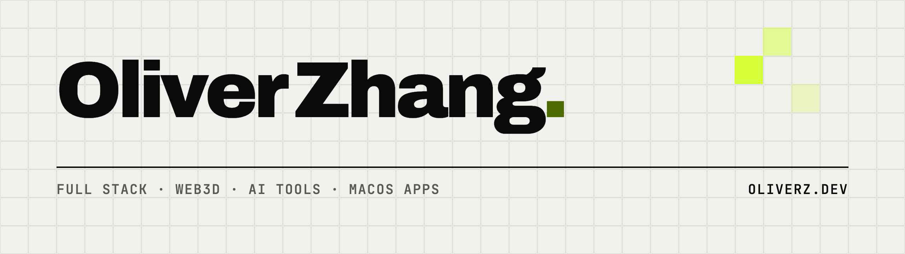

<a href="https://oliverz.dev">
  <picture>
    <source media="(prefers-color-scheme: dark)" srcset="assets/banner-dark.png">
    
  </picture>
</a>

I build full-stack products, Web3D and AR/XR experiences, and free, open-source Mac apps. I also make short videos about how tech works.

[oliverz.dev](https://oliverz.dev) · [中文](https://oliverz.dev/zh) · [Português](https://oliverz.dev/pt-br) · [YouTube](https://www.youtube.com/@oliverzdev) · [X](https://x.com/oliverzdev) · [LinkedIn](https://www.linkedin.com/in/oliverzdev/)

## Apps

<table>
  <tr>
    <td width="96" valign="top"></td>
    <td valign="top">
      <b><a href="https://oliverz.dev/products/tsuba">Tsuba</a></b>: checks unfamiliar code before it runs for the first time on your Mac: <code>curl | bash</code>, npm installs, cloned repos, DMGs, VS Code extensions and MCP servers. Built after a fake Upwork job got malware onto my Mac. 
      macOS menu bar app · Rust, TypeScript · <a href="https://github.com/chihyungchang/Tsuba">Source</a> · <a href="https://oliverz.dev/blog/upwork-contagious-interview">The story</a>
    </td>
  </tr>
  <tr>
    <td width="96" valign="top"></td>
    <td valign="top">
      <b><a href="https://oliverz.dev/products/shotloop">Shotloop</a></b>: make short explainer videos from code with AI, one shot at a time. 2D shots in HTML or 3D in Blender, each checked and fixed on its own, so a fix re-renders one shot, not the film. 
      macOS app · Rust, TypeScript, Python · <a href="https://github.com/chihyungchang/Shotloop">Source</a>
    </td>
  </tr>
</table>

Both are free and Apache 2.0.

## Writing

<!-- BLOG-POST-LIST:START -->
- [How long would a hacker need to crack your password?](https://oliverz.dev/blog/password-crack-time)
- [Two fake Upwork jobs, one infected Mac: my run-ins with North Korea's Contagious Interview](https://oliverz.dev/blog/upwork-contagious-interview)
<!-- BLOG-POST-LIST:END -->

## Also on GitHub

- [8thwall-vue3-threejs-boilerplate](https://github.com/chihyungchang/8thwall-vue3-threejs-boilerplate): a starter for 8th Wall WebAR projects with Vue 3, Three.js and TypeScript.
- [postchild](https://github.com/chihyungchang/postchild): a free, Postman-style API request builder in the browser.
- [TCM-Body-Constitution-Test](https://github.com/chihyungchang/TCM-Body-Constitution-Test): which of the nine Traditional Chinese Medicine body constitutions fits you.
- [p5js-learning](https://github.com/chihyungchang/p5js-learning): my p5.js sketches and notes. More generative work in the [Lab](https://oliverz.dev/lab).

TypeScript · Vue · React · Three.js · WebGL · WebXR · Node.js · NestJS · Rust · Tauri · Blender
